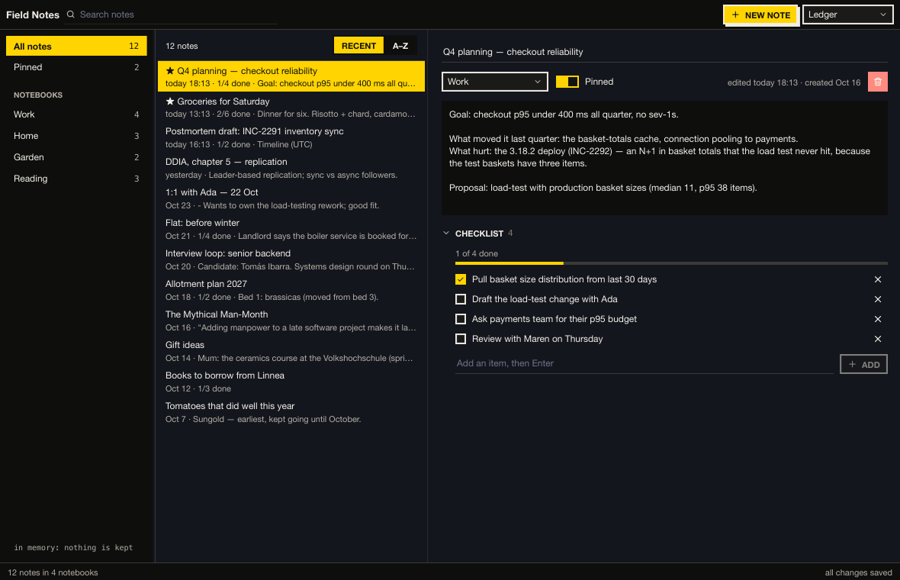

# Field Notes

Notes with checklists, in notebooks, kept in sqlite — on the `kui` runner
and Kit. Notebooks in a sidebar with counts, the notes list (pinned
first, or A–Z), a search across titles, bodies and checklist items, and
the open note: its title, notebook, pin, body and a checklist with
progress. Edits save themselves half a second after the typing stops; a
delete asks first. A new file starts with a few weeks of believable notes.



```bash
kui run addons/kit/samples/field-notes                          # ~/.local/share/kui-samples/field-notes.db
kui run addons/kit/samples/field-notes -- --db :memory:         # a fresh, seeded book each run
```

Kit here: `split` (nested), `list`, `search`, `segmented`, `text_field`
(with `focus`), `select`, `switch`, `icon_button`, `section`, `checkbox`
(`grow`), `progress`, `button`, `empty`, `notice`, `inspector`,
`divider`, `toast`, `toolbar`, `statusbar`; the body is a core multi-line
`edit`.

## Tests and pictures

```bash
cd addons/kit/samples/field-notes && kui run test --headless    # a temp sqlite file, edited and read back
nu addons/kit/samples/shots.nu field-notes
```
