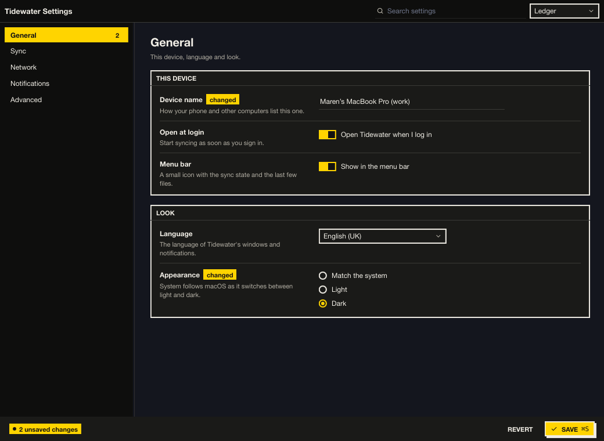

# Preferences

A settings window on the `kui` runner and Kit — the preferences of
Tidewater, a pretend photo and file sync client. Five sections in a
sidebar (with counts of what changed, or what is wrong), each a few
panels of settings: a label, a line of help and a control — switches,
sliders, selects, radio groups, a segmented direction, a tri-state
"all folders" box, text fields validated as you type (errors block the
save, warnings do not). A search finds a setting by its words across
sections. Save writes TOML; Revert and "Reset all" (confirmed) undo.



```bash
kui run addons/kit/samples/preferences                                # ~/.config/kui-samples/tidewater.toml
kui run addons/kit/samples/preferences -- --config /tmp/tidewater.toml
```

Kit here: `switch`, `slider`, `select`, `radio_group`, `segmented`,
`checkbox` (`mixed`), `text_field` (`disabled`), `search`, `panel`,
`badge`, `divider`, `code`, `notice`, `empty`, `button`, `toast`,
`split`, `toolbar`, `statusbar`.

## Tests and pictures

```bash
cd addons/kit/samples/preferences && kui run test --headless    # a temp TOML file, saved and read back
nu addons/kit/samples/shots.nu preferences
```
