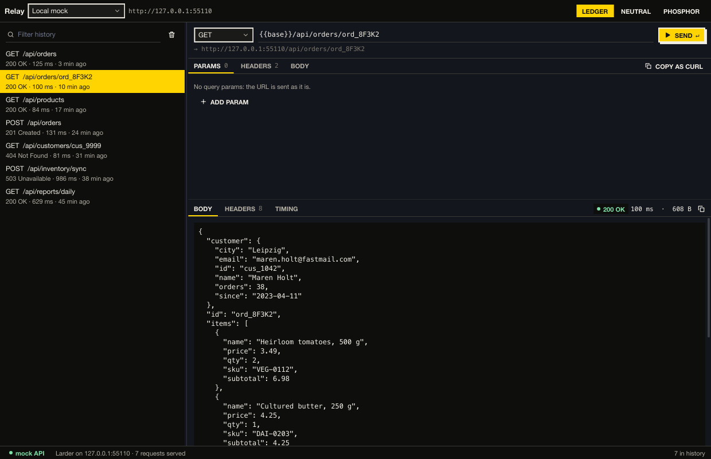

# Relay

An HTTP client on the `kui` runner and Kit. It serves its own dummy API —
Larder, a grocery-delivery backend (`api.lua`, `kui.http.serve`) — and
talks to it: a method and URL bar with `{{base}}` filled in from the
environment, params and headers as tickable rows, a JSON body, and the
response's status, body, headers and a timing waterfall built from the
server's `Server-Timing`. The history on the left was really sent at
start; pick one to load it, filter it, or copy any request as curl.
"Staging (offline)" points at a closed port, for the error state.



```bash
kui run addons/kit/samples/relay                   # the mock API on :4317 (a free port if taken)
kui run addons/kit/samples/relay -- --port 4400
```

Kit here: `split` (both ways), `tabs` with trailing groups, `list`,
`search`, `select`, `text_field`, `checkbox`, `button`, `icon_button`,
`badge`, `code`, `inspector`, `waterfall`, `notice`, `empty`, `progress`,
`toolbar`, `statusbar`, `segmented`, `toast`; the body editor is a core
`edit` (Kit has no multi-line field).

## Tests and pictures

```bash
cd addons/kit/samples/relay && kui run test --headless    # real requests through update(); exit code = failures
nu addons/kit/samples/shots.nu relay                        # shots/*.png from test/shot.lua and test/shots.nuon
```
