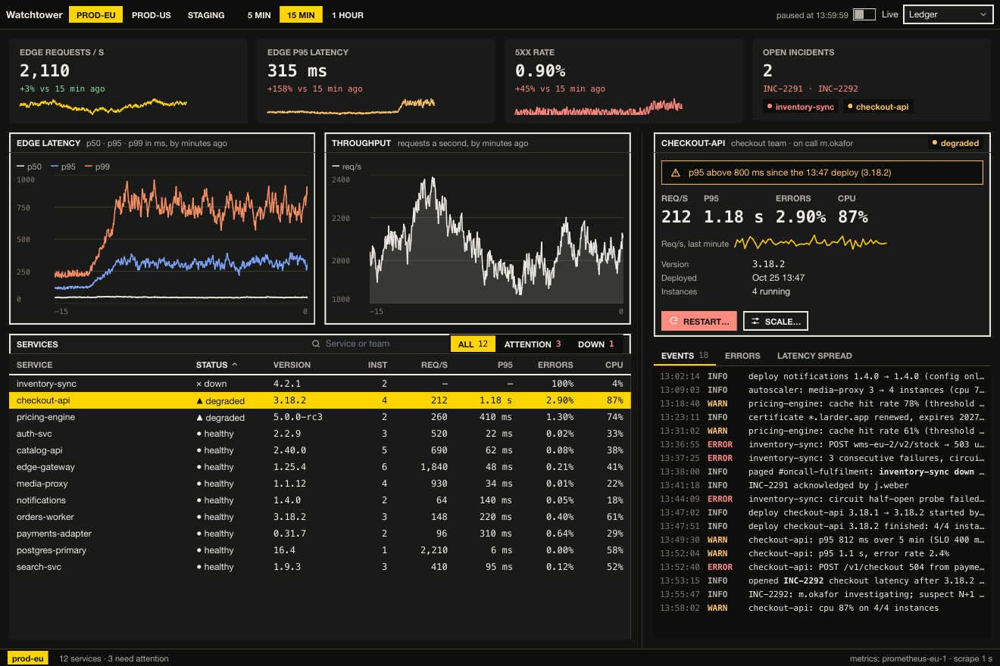

# Watchtower

An ops dashboard on the `kui` runner and Kit, written in Teal. Larder's
twelve services mid-incident (checkout slow since a deploy, the inventory
sync down with the warehouse): headline numbers with sparklines, the
edge's latency and throughput as live line charts, a sortable, filterable
services table, the selected service's detail with a rolling restart
(confirmed) and a scale (a popover with a slider), and an events pane
with the log, errors by service and the latency spread. A timer moves the
simulated fleet (`fleet.tl`) a second at a time.



```bash
kui run addons/kit/samples/watchtower
kui check addons/kit/samples/watchtower     # the Teal types
```

Kit here: `stat`, `sparkline`, `line_chart` (live `window`), `bar_chart`,
`histogram`, `table` (sort, select), `log`, `panel` with actions and
footer, `tabs`, `segmented` with counts and alerts, `search`, `switch`,
`select`, `badge`, `notice`, `inspector`, `popover`, `slider`, `button`,
`empty`, `toast`, `split`, `toolbar`, `statusbar`.

## Tests and pictures

```bash
cd addons/kit/samples/watchtower && kui run test --headless
nu addons/kit/samples/shots.nu watchtower
```
