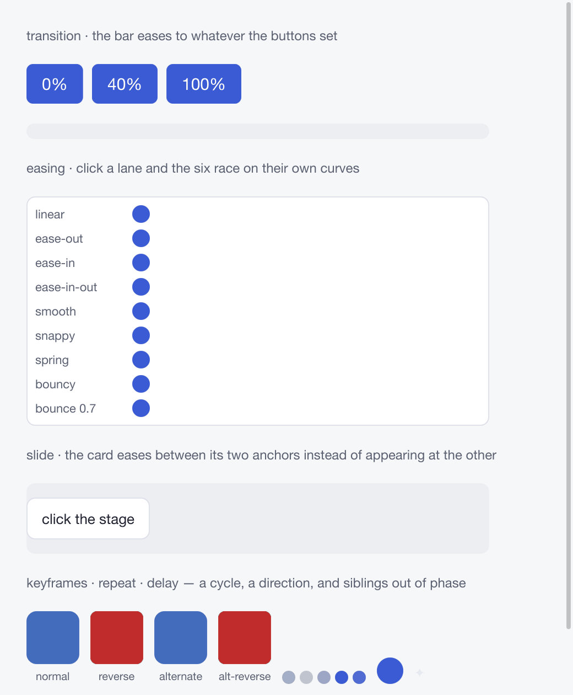

# `features/transition.rs`

<!-- Written by scripts/book-examples.nu; the source is included when the book is built. -->



*The example as it draws: its recording, played headlessly by `--record`.*

```rust,noplayground
{{#include ../../../../../examples/rust/features/transition.rs}}
```
