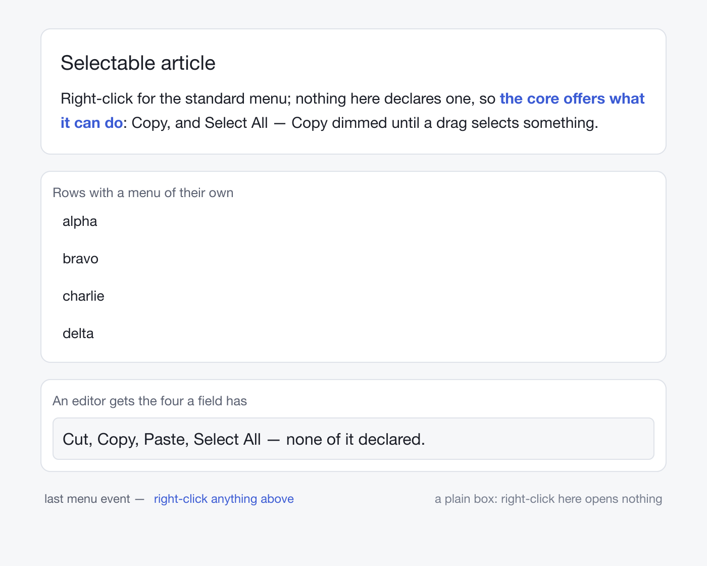

# `widgets/context_menu.rs`

<!-- Written by scripts/book-examples.nu; the source is included when the book is built. -->



*The example as it draws: its settled frame, drawn headlessly by `--shot`.*

```rust,noplayground
{{#include ../../../../../examples/rust/widgets/context_menu.rs}}
```
