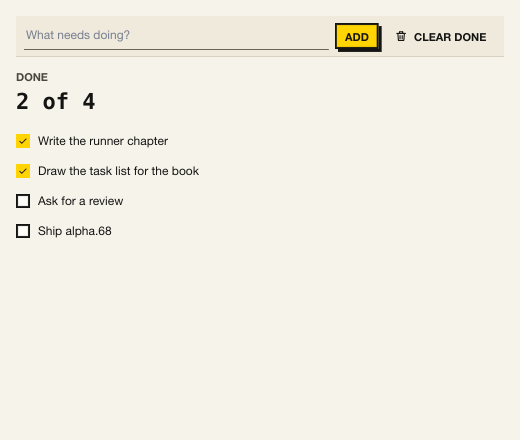

# Apps in Lua: Kit and the runner

At the end of this chapter, a task list runs from one Lua file, with no
Rust of your own, drawn by Kit — and a test checks it without a window.



## The host you do not write

The last chapter's host was yours. `kui` is one written for you
([ADR 0064](https://github.com/qxuken/kui/blob/main/docs/adr/0064-the-kui-runner.md)):
a binary that opens the window, loads your script as the app, loads
**Kit** beside it — a UI kit of ready components, drawn in a skin — and
gives the script a standard library: files, processes, HTTP, timers,
tasks. Install it with the script each release carries (Windows has
`install.ps1` beside it), or from npm:

```bash
curl -fsSL https://github.com/qxuken/kui/releases/download/v0.1.0-alpha.68/install.sh | sh
```

```bash
npm i -g @qxuken/kui-cli
```

`kui upgrade` later moves it to the newest release.

Then start an app, and run it:

```bash
kui new tasks
```

```bash
kui run --watch tasks
```

`--watch` reloads the script when you save it and keeps the model, so the
window you are looking at is the one you are editing.

## The folder

An app is a folder. `kui.config.lua` names it, gives it an `id` and a
version, and says its entry and its window:

```lua
{{#include ../../../examples/lua/tutorial/tasks/kui.config.lua:config}}
```

The entry is a kui-lua script, the kind chapter 13's plugins were, with
three globals the runner looks for: `init`, `update` and `view`. It is
the loop of chapter 4, in Lua.

## The model

`init()` returns the model, which the runner keeps in the global
`model`. It reads the tasks from a file, if there is one — a call that
waits, at the top level, which is fine before the window opens:

```lua
{{#include ../../../examples/lua/tutorial/tasks/main.lua:init}}
```

Where the file is comes from the command line. `kui.parse_args` reads
the app's own arguments — what follows `--` — against a spec, and
writes `--help` from it:

```lua
{{#include ../../../examples/lua/tutorial/tasks/main.lua:args}}
```

```bash
kui run tasks -- --file /tmp/tasks.json
```

## The view, from Kit

`require("kit.ui")` is Kit's components as functions. Each takes its
props and, where it holds any, its children; an `on_*` prop is the
message its event arrives as. The rest is the Lua builders chapter 13's plugins used —
`column`, `text` — with `$kitBg`, Kit's colour for a window's ground:

```lua
{{#include ../../../examples/lua/tutorial/tasks/main.lua:view}}
```

A Kit component is a component in chapter 13's sense: the runner loaded
Kit as an extension, and `kit.button(…)` places `kit/button`. Its
events are your messages, with the event's fields under the event's
name — a checkbox's `toggle = { checked }`, a field's `change = { text }`.

## Update

`update(msg)` hears every message — your nodes', Kit's, and what the
app dispatches itself — and changes `model`. The next frame draws it:

```lua
{{#include ../../../examples/lua/tutorial/tasks/main.lua:update}}
```

An empty task is refused with `error`, which Kit draws under the field
in the danger colour and reads after its name.

## A task, so the window keeps drawing

Saving writes a file. A call that waits, made from `update`, would stop
the frame until it returned; inside `kui.spawn` it yields instead, and
the window keeps drawing. When it is done, the task hands a message back
with `kui.dispatch`:

```lua
{{#include ../../../examples/lua/tutorial/tasks/main.lua:save}}
```

`kui.json.array` marks the list, so that an empty one is written `[]`
and not `{}`.

## The test

A test is another script that loads the app and drives `update`, run
with no window. Its exit code is its failures:

```lua
{{#include ../../../examples/lua/tutorial/tasks/test/main.lua:test}}
```

```bash
cd tasks && kui run test --headless
```

A task that throws ends a headless run with 1, so a broken test fails
rather than waits.

## Shipping it

Your users should not need `kui`. `kui pack` builds the app for them —
for every platform, from your machine, because the app is Lua and only
the runner differs, and the release has a runner for each:

```bash
kui pack tasks --target all --installer https://example.com/tasks/
```

`dist/` then holds a `.app` for macOS, an `.exe` for Windows, a binary for
each Linux, `SHA256SUMS`, and an `install.sh` and `install.ps1` that
fetch the right one from the URL you gave. Upload the folder there, and
`curl -fsSL https://example.com/tasks/install.sh | sh` installs it.
`--format npm` writes a package instead, for a team that already has
Node and a registry of its own.

The `id` is what names the app's own folder, `kui.data_dir` — which is
why the task list keeps its file there: a packed app's own files are
read-only.

## Where the runner goes from here

- **The standard library** — `kui.http` (a client and a server),
  `kui.process`, `kui.timer`, `kui.fs.walk`, workers on other cores,
  sqlite — is listed in the
  [runner's README](https://github.com/qxuken/kui/blob/main/crates/kui-cli/README.md).
- **Kit** — fields, tables of a hundred thousand rows, charts, a trace
  waterfall, dialogs, toasts, three skins — is in
  [`addons/kit`](https://github.com/qxuken/kui/tree/main/addons/kit);
  `kui run addons/kit/app` opens its gallery.
- **The samples** in
  [`addons/kit/samples`](https://github.com/qxuken/kui/tree/main/addons/kit/samples)
  are four whole apps on the runner: an HTTP client with its own mock
  API, an ops dashboard in Teal, notes in sqlite, a settings window.
- **Teal**, typed Lua: name the entry `main.tl` and `kui check` types
  it against kui's, Kit's and the runner's declarations.
- **Devtools**: `kui run --devtools` opens the panel, and its Log tab
  has what the app printed.
