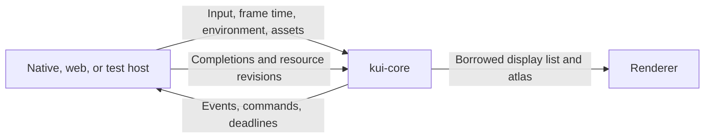

# Extracting system integration from kui-core

Implementation plan for C-sys, audited at `0119797f` on November 7, 2026. It updates the scope of the [system draft](adr/drafts/the-core-reaches-the-system-through-kui-native.md). The Kit channel and perf inspector are already in this checkout, so the draft’s original sequencing dependency has been met. The [general file I/O proposal](adr/drafts/the-cores-io-asks.md) can follow separately.

## Where the seam goes

`kui-core` owns UI state, layout, shaping, glyph rasterization, input routing, accessibility derivation, and display lists. Its ordinary frame and input paths use supplied time, environment, and in-memory resources. `kui-native::system` discovers and prepares those inputs, owns filesystem and process effects, and works in a host that brings its own window or renderer. `kui-native`’s runner wires the system module to the core and to `kui-wgpu`. A web host and a test driver can supply their own inputs and handle the same outputs.

Use the existing `Core::set_time`, `Core::set_platform`, `Env`, `Session::with_fonts`, `Core::output`, and typed command queues as starting points. Keep `Core` and `Session` concrete. Use a narrow recorder clock for elapsed time within a span, only when recording is enabled. Use narrow compatibility adapters for synchronous path-based entry points where callers need the existing semantics. Avoid the draft’s general `Platform` trait for files, clocks, fonts, and capture policy. `rules::Platform` already names the value that drives platform conditions and interaction conventions. State, allocation, in-process caches, and thread-local scratch still belong in the core. [Runtime](../crates/kui-core/src/runtime.rs) · [Session](../crates/kui-core/src/session.rs) · [Platform rules](../crates/kui-core/src/rules.rs)

## System access before extraction

| Area | Current access and timing | Extraction |
| --- | --- | --- |
| Font discovery | `Core::new` → `Session::new` → `text::new_font_system` → cached `FontSystem::new`. The dependency scans installed faces and asks the system locale. Validation can spawn `kui-font-check` threads and open font files again. Generic families and cosmic-text’s fallback lists vary by build target. | Native prepares and caches a shareable catalog, including locale and family preferences. Core validates in-memory faces, constructs its shaping state, and applies app fallback preferences. [Text](../crates/kui-core/src/text.rs) |
| Font access after discovery | `load_font_file`, recursive `load_fonts_dir`, `reload_system_fonts`, `apply_system_fonts`, and `share_faces` open or map files. Unshared faces can cause file access while shaping or ranking weights. Even `add_font_data` and the first named family can trigger sharing of installed faces. | Native opens/maps before handing over a batch. Core merges prepared faces and owns IDs, resource registration, and cache revisions. [Font resources](../crates/kui-core/src/runtime/resources_api.rs) |
| SVG source | `SvgSource::File` does a metadata check once per path per core frame that reaches it, reads on stamp change, and caches by content hash. `SvgSource::Data` can also read a file through `usvg`’s default string href resolver. Both initial parse and recolor use default resolver options. | Explicitly disable external hrefs in both parsing paths. Use an asset snapshot for file sources, with a narrowly scoped native compatibility path for synchronous first use. [SVG node](../crates/kui-core/src/runtime/svg_node.rs) · [SVG parser and rasterizer](../crates/kui-core/src/svg.rs) |
| Design tokens | `dtcg::from_path` reads the root. `from_str` also reads when given a base and a resolver with relative `$ref`s. One parsed-document cache serves both appearance halves. | Keep JSON, references, and token conversion in core. Pass in the root text and a document resolver. Native owns path resolution and reads. [DTCG](../crates/kui-core/src/dtcg.rs) · [ADR 0062](adr/0062-design-tokens-loaded-from-a-dtcg-file.md) |
| Perf measurement | `Recorder` creates its own `Instant` epoch, reads `SystemTime` for session metadata, and samples CPU with `CLOCK_THREAD_CPUTIME_ID` on Unix. Thread-local `Here` has its own direct reads for nested spans without a `Core` reference. Optional `tracing` reaches the process’s subscriber. | Inject recorder clock and metadata, share that clock with `Here`, and keep observer work behind the measuring check. Move Unix clock code and the direct `libc` dependency to native. [Recorder](../crates/kui-core/src/runtime/perf.rs) |
| Perf output | `perf_from_env` reads `KUI_PERF_TRACE`. `perf_trace_to` opens a file, streams native-format records during recording or accumulates a converted format, and writes on flush or drop. | Native owns environment policy, stream output, converted-format writes, and shutdown. Core retains the in-memory recording and hands out ordered records or encoded batches only when requested. [Recorder](../crates/kui-core/src/runtime/perf.rs) · [ADR 0058](adr/0058-a-recording-is-a-timeline.md) |
| Devtools | Core reads `KUI_DEVTOOLS` and `KUI_SMOKE_FRAMES`. Capture naming reads `KUI_CAPTURE_DIR`, the home and temp folders, directory metadata, and wall time. The Perf tab writes a trace during `begin_frame` and queues opening the inspector on success. | Native owns launch config, destination selection, naming, saving, and inspector launch. Core queues a typed request and consumes the result. [Devtools](../crates/kui-core/src/runtime/devtools/mod.rs) · [Native startup](../crates/kui-native/src/lib.rs) |
| Build-target behavior | `Platform::current`, `KeyMods::with_primary`, stock caption metrics, and the initial raster hinting choose defaults using the build target. `set_platform` already supplies much of the runtime policy. | Initialize the core from explicit conventions. Preserve native convenience defaults at native entry points. Audit keyboard helpers, metrics, glyph hinting, menu labels, and the binding-facing platform name together. [Input](../crates/kui-core/src/input.rs) · [Metrics](../crates/kui-core/src/metrics.rs) · [Platform rules](../crates/kui-core/src/runtime/when.rs) |
| Transitive host code | cosmic-text’s default features enable fontconfig where supported. Its `std` feature also enables fontdb’s file and mmap support and `sys-locale`. `kui-trace` exports a `FileTransport` and polling `Watch` in the same crate as its in-memory codec. | Select text features explicitly and enforce the allowed source variants and constructors. Feature-gate trace file transport and watchers for tooling consumers. Keep generic in-memory codec and transport interfaces available to core. [Core manifest](../crates/kui-core/Cargo.toml) · [Trace exports](../crates/kui-trace/src/lib.rs) |

Audio, clipboard, menus, dialogs, windows, accessibility, and captures already have a workable seam. Core emits commands, derived state, or requests. Drivers interpret those and feed back results. The existing window loop also stamps the animation clock before input and app handlers, which keeps deadlines correct after idle. Preserve those paths and the borrowed display list and atlas. Shader validation with Naga, path rasterization, and SVG rasterization over supplied bytes are computation. [Native runner](../crates/kui-native/src/lib.rs) · [Headless runner](../crates/kui-native/src/headless.rs) · [Effects as data](adr/0013-effects-as-data.md)

## Implementation sequence

### 1. Establish the baseline and native construction path

- Record comparable release baselines before changing constructors. Include first native session, first text frame, warm second session, first custom-family measure, rescan, warmed frame work, and trace streaming. Use the same installed or fixture fonts, fallback order, viewport, scale, toolchain, and bench profile on both refs.
- Extend the existing `kui_native::system` module. Add native constructors or factories that return the existing `Session` and `Core` types. Gate runner and GPU code behind a default `gui` feature and make the corresponding dependencies optional. Keep the system-only build usable by headless FFI and Lua path helpers. Set workspace dependency feature defaults deliberately and check individual packages so workspace feature unification cannot conceal a GUI dependency.
- Route the runner’s `main_core_for`, standalone C/Odin `kui_ctx_new`, Node context creation including the persistent headless context, and Rust host-pass examples through native construction where they currently expect installed fonts. Popup, island, and `new_in` paths inherit the supplied session. A `Launcher::core` supplied by a caller retains that session and its fonts. Audit scripts, examples, and test constructors that obtain `Core` via the `kui-native` re-export. [Native startup](../crates/kui-native/src/lib.rs) · [FFI lifecycle](../crates/kui-ffi/src/lib.rs) · [Node contexts](../crates/kui-node/src/lib.rs) · [Host pass](../examples/rust/apps/host_pass/main.rs)

### 2. Make fonts resident inputs

- Introduce a prepared catalog for `Session`, building on `with_fonts`. Carry locale, generic-family choices, fallback policy, and stable source identities separately from the shared byte backing. Native may use a validated shared mapping where appropriate. A catalog accepted by core must contain readable in-memory sources, with no `Source::File` path capable of opening a file later. Keep production bare sessions and test sessions on the same construction path, using the existing last-resort font and explicit fixture fonts respectively.
- Preserve the process-wide native scan cache and per-session shaping cache. Parse and validate each file or collection once on ingestion, sharing backing across faces and sessions. Keep the existing native parallel scan/check behavior initially. Prototype mapping during scan and measure time to the first visible text frame and peak memory. If it regresses, test native preparation earlier in launcher startup or in parallel with independent startup work. Require the same installed families and fallback coverage at the first native frame. The current source reports about 30 ms to share the catalog once on a Mac and about 9.7 ms versus 0.42 ms for first-family ranking before and after sharing. Those are historical measurements. Moving all mappings into startup can trade one hitch for another.
- For reload, prepare a new snapshot outside the session borrow and merge additions and removals into the live database from prepared faces. Preserve surviving face IDs, the source/index identity of collections, explicitly loaded app faces, the session’s locale semantics, and the existing `fonts` event and cache invalidations across all windows. A no-op scan must stay a no-op. Preserve the existing add/remove semantics for a file replaced in place under the same path. Apply a completed snapshot between input or frame turns, and discard stale results if scans can overlap. Native retains OS notifications and redraw routing. [Font merge](../crates/kui-core/src/runtime/resources_api.rs) · [Native notifications](../crates/kui-native/src/system_fonts.rs)
- Move path and directory loaders to native helpers backed by the same prepared input. Preserve C/Odin, Node, and Lua names and result shapes. Rust callers with a raw `Core` get a documented mechanical migration to native helpers. Kawoosh exercises both setup-time loads and a `ui.core().load_font_file` during user-font refresh, so verify that path in the same turn and keep bulk preparation out of normal rendering. Use explicit fixture fonts for portable layout tests and real OS fonts for adapter parity. [Lua binding](../crates/kui-lua/src/lib.rs) · [FFI resources](../crates/kui-ffi/src/resources.rs) · [Font resource tests](../crates/kui-core/src/runtime/resources_api.rs)

### 3. Extract SVG and DTCG path handling

- Fix the SVG href resolver first. Supply the same explicit resolver options for initial parse and recolor. Keep `data:` behavior and reject external string hrefs as ADR 0063 specifies. Test with a real external SVG present and absent, and an embedded SVG that still renders. [ADR 0063](adr/0063-an-svg-element.md)
- Keep SVG document and raster caches in core. Publish native file revisions with shared bytes or a read error. Hash and parse when content changes, and invalidate dependent retained slots and layout when the source changes. A preloaded path or byte source must draw on the first frame. Handle missing → created, modified, removed, multiple users of a path, and a file changing while a load is in flight.
- Preserve legacy `src` for native callers with dynamic paths using a narrowly scoped native resolver during the transition. Retain the existing one-check-per-path-per-core-frame ceiling there. The portable path uses preloaded data or a cache miss request followed by completion and redraw. A first-seen dynamic path cannot both read from disk off the frame and appear in that same frame. Keep the synchronous adapter for compatibility until callers have a preload or an explicit asynchronous contract. The data-only path adds no resolver call and warm preloaded paths do no stat, read, or rehash.
- Extract DTCG path loading behind a per-load document resolver, with an in-memory map for tests and web. Resolve local relative paths using the native adapter, preserving existing reference-base rules, fragment parsing, diagnostics, and cache reuse across light and dark. Preserve remote-reference rejection and the Lua extension’s current path handling. Switch Rust file helpers and C/Odin, Node, and Lua wrappers together. [DTCG implementation](../crates/kui-core/src/dtcg.rs) · [FFI loader](../crates/kui-ffi/src/lib.rs)

### 4. Separate logical time, instrumentation, and file output

- Keep logical time as a supplied value via `set_time`. For recording, inject a small monotonic microsecond clock, optional thread CPU readings, and session wall-time metadata. A fake can advance within a frame. Ensure `Recorder` and thread-local `Here` use the same source and epoch for nesting, cut spans, and reentrant windows. Keep `why == 0` ahead of clock reads, observer calls, allocations, and TLS changes. Preserve `tracing` live span nesting when enabled by wiring the subscriber adapter explicitly.
- Move file ownership and lifecycle to the native recorder. Reuse the trace encoder and buffers. Drain ordered batches at existing driver turns, including input and idle turns, so out-of-frame records reach live readers. Preserve header/name/track order, first-frame context, flush visibility, converted formats, write errors, and finish-on-exit including paths where the runner never drops `Core`. Route explicit flush through the driver or host-owned recording handle, including the existing C and Node doors where a driver owns the recording. If output runs on a worker, use bounded reusable buffers with explicit backpressure and a flush acknowledgement. Measure active recording overhead and ensure the live reader can still follow a growing trace. [Trace encoder](../crates/kui-trace/src/codec.rs) · [Recorder context tests](../crates/kui-core/tests/perf_context.rs) · [Perf inspector](../tools/kui-perf/README.md)
- Apply native launch settings before the first frame, preserving launcher overrides and the headless runner’s `KUI_DEVTOOLS` behavior. Queue a typed devtools export request carrying the selected trace snapshot and whether to inspect it, or a capture request carrying its format. Native chooses the destination and sends success or failure back to the requesting panel. Open the inspector only after a successful save. Preserve docked and detached panel behavior, capture completion, and app-specified destinations. Reuse the existing capture plumbing where it fits. A single export request lets this slice land independently of general file I/O. [Devtools export](../crates/kui-core/src/runtime/devtools/mod.rs) · [Native captures](../crates/kui-native/src/capture.rs)

### 5. Make the portable configuration the default in core

- Switch `Core::new` and `Session::new` to portable defaults after native, binding, and test construction paths are wired. Use the same defaults in unit tests, integration tests, and published core. Pin locale, font bytes, metrics, and logical time explicitly in reproducibility tests. Keep a separate adapter suite for system font discovery, locale, paths, env overrides, and trace files. Document the direct Rust constructor and path-loader migrations in the changelog and headless chapter.
- Replace internal build-target defaults with supplied policy. Keep platform-aware input and caption behavior intact for desktop, including pinned test platforms. Agree on the public representation of a generic platform before adding any browser or mobile schema spellings. Test native, default core, and core with optional features off. Use Clippy’s exact disallowed method paths with test-only exceptions, plus a production-source check for implicit platform choices and file-backed font sources. Inspect dependency features in a core-only build, in native system-only builds, and in normal workspace builds. `cosmic-text/std` keeps some host-capable code available even with fontconfig off, so the proof also needs an enforced prepared-font invariant and runtime tests.
- Add a `wasm32-unknown-unknown` runtime smoke covering two frames with a supplied font, input, a timed transition, a mock command completion, and a recorded span. Compare semantic output with the same native fixture. Browser integration can use bundled or fetched font bytes and a host monotonic clock. A later browser renderer needs a separate pass for GPU timing and asynchronous readback. `kui-wgpu` currently times surface acquisition with `Instant` and its native readback waits by polling and sleeping and requires `PendingCapture: Send`. Mobile uses the same core inputs with host-specific input, IME, accessibility, surface lifecycle, and display timing. [Rust WebAssembly target](https://doc.rust-lang.org/rustc/platform-support/wasm32-unknown-unknown.html) · [High Resolution Time](https://www.w3.org/TR/hr-time-3/#dom-performance-now) · [Renderer](../crates/kui-wgpu/src/lib.rs)

## Merge gates

| Check | Pass condition |
| --- | --- |
| Ordinary frame and input cost | No new host dispatch, clock read, syscall, allocation, or display-list copy in the common path. Compare interleaved base/candidate runs with `scripts/bench-check.nu 0119797f`. Inspect `frame_1k_typical`, `frame_10k_rects_with_text_and_hits`, access-tree and virtual-list rows, plus the `editing`, `cells`, and `long_line` benches. Repeat noisy runs and investigate repeatable regressions even when they fall below the script’s default 10% threshold. |
| Font startup and memory | Compare release cold-process and warm-session medians and tails, time to first visible text, first custom family, process RSS and mapping count, and scan time on macOS, Windows, and Linux. Include a large installed catalog and TTC/variable faces. Check a multi-window rescan and verify native shaping does zero font-file opens after preparation. |
| Asset and trace costs | Compare steady and modified SVG sources, SVG data, first dynamic source, tracing off and on, native stream throughput and frame p95/p99 with a slow sink, and export completion latency. Assert stable SVG resources do no extra read, hash, parse, or raster work. Check live tailing, explicit flush, failure, and shutdown. |
| Host parity | Run `nu scripts/test.nu`, cross-binding conformance, headless and native smoke, and the host-pass example. Exercise macOS/Windows/Linux system adapters and replay identical fixture inputs with a fake clock. Test Kawoosh’s font picker and font refresh and Carnet’s `Drive`-based layout tests against the candidate. |
| Build and portability | Check the native system-only graph and runner-less FFI with and without `access`, preserving the slim graph and comparing release artifact size. Verify a core-only Wasm build and execute the runtime smoke. Keep the same effect ordering and borrowed renderer input through the migration. |

## Phase 1 measurements

Apple M3 Pro, macOS 27.0.1, arm64, Rust 1.99.1, `C.UTF-8`, 686 installed font families and Menlo as the named family. Each sample starts a new process with warm filesystem caches. The probe builds an 800×600 display list at 2× with 24 labels, then measures 2,000 warm frames without a recorder and 2,000 frames streaming `.kuitrace` to local disk. Startup figures cover core construction and CPU display-list generation. They exclude window creation and GPU presentation. [Probe source](../scripts/core-system-baseline.rs)

The first 21 runs completed before constructor wiring changed. The paired run alternated the order of the baseline and Phase 1 binaries across 21 pairs. Frame percentiles in the table are medians of per-process percentiles.

| Workload | Initial baseline | Paired baseline | Phase 1 |
| --- | ---: | ---: | ---: |
| First core | 22.62 ms | 23.01 ms | 23.18 ms |
| First text frame | 8.84 ms | 9.34 ms | 9.10 ms |
| Startup through first text | 31.87 ms | 32.25 ms | 32.17 ms |
| Second core | 147 µs | 151 µs | 156 µs |
| First named-font registration | 28.93 ms | 29.66 ms | 29.79 ms |
| First measure using that family | 571 µs | 576 µs | 576 µs |
| Unchanged rescan | 19.49 ms | 19.63 ms | 19.76 ms |
| Warm frame p50 / p95 | 7.71 / 9.67 µs | 7.71 / 9.21 µs | 7.75 / 9.71 µs |
| Streaming frame p50 / p95 | 28.75 / 36.62 µs | 28.92 / 36.92 µs | 28.75 / 36.88 µs |
| Explicit trace flush | 10.62 µs | 9.00 µs | 8.96 µs |
| Trace size for 2,000 frames | 406,395 B | 406,395 B | 406,395 B |
| Peak process RSS | 21.91 MiB | 21.91 MiB | 22.03 MiB |

Initial startup p95 was 32.46 ms. The warm-frame p95 varied between the two baseline rounds by about as much as it did in the paired comparison. The runner-less FFI dylib built with `--no-default-features` was 12,505,264 B at baseline and 12,505,232 B in Phase 1. It exported the same 400 `kui_*` symbols. The isolated system adapter and runner-less FFI graphs, including FFI with `access`, contained neither winit nor wgpu.

The existing Divan frame benchmark on `0119797f`, with `CARGO_PROFILE_BENCH_CODEGEN_UNITS=1`, measured medians of 132.3 µs for `frame_1k_typical`, 1.362 ms for `frame_10k_rects_with_text_and_hits`, 1.516 ms for `frame_10k_rects_with_access_tree`, and 21.12 µs for `list_10k_rows_virtual`. [Frame benchmark](../crates/kui-core/benches/frame.rs)

For a separate 15-pair experiment, moving the existing first named-font registration ahead of the first frame emulated eager mapping of the current catalog. It reduced the frame alone to 0.89 ms but raised combined startup from 32.71 ms to 53.16 ms. Phase 1 therefore keeps the existing font path through the new `kui_native::system` factories. Phase 2 should measure a native preparation pass that can share each file’s backing from discovery onward, including the cost through the first frame. Simply adding the current mapping pass to startup would miss the baseline. [Native factories](../crates/kui-native/src/system.rs)

To repeat the probe, build `kui-ffi` in release with `--no-default-features` and collect the matching `kui_core` and `kui_native` `.rlib` paths from Cargo’s `--message-format=json` output. Compile `scripts/core-system-baseline.rs` with `rustc --edition=2024 -C opt-level=3 -L dependency=target/release/deps --extern kui_core=<rlib>`. For the Phase 1 path, add `--cfg kui_native_host --extern kui_native=<rlib>`. Run one process per sample with `Menlo` and a fresh scratch `.kuitrace` path. On macOS, `/usr/bin/time -l` reports the peak RSS separately. The probe writes CSV in the order shown in `main` and removes its trace when it finishes.

## Audit verification

- At the audited revision, 15 integration tests passed across SVG, DTCG, platform pinning, and trace context, as did 91 core runtime unit tests. The runner-less FFI dependency graph contained no `kui-native`, `kui-wgpu`, winit, or wgpu.
- A native probe rasterized a red pixel from an SVG `<image>` that named an external file. The same input rasterized transparent after removing that file. This verifies the implicit filesystem read through `usvg`.
- The pinned Rust 1.99.1 toolchain built `kui-core` for `wasm32-unknown-unknown`. A temporary Node-hosted Wasm probe emitted quads for both a bare frame and a frame using bundled Noto Sans. Enabling the recorder trapped in `SystemTime::now`. These are runtime observations on the current core. Candidate performance measurements belong to the merge gates above.

## Completed extraction

`Core::new` and `Session::new` start with portable platform conventions and a last-resort face. A host can supply a bundled font session, a prepared font catalog, SVG snapshots, a DTCG document resolver, and a recording clock and output adapter. The core still owns shaping, layout, caches, and the borrowed display list and atlas. CI checks the effect boundary with Clippy and compares the same deterministic text, animation, dialog, and recording fixture on native Rust and Node-hosted Wasm. [Portable fixture](../scripts/portable-core-smoke.rs)

Native desktop callers that construct a core directly use `kui_native::system::new_core()` for installed fonts, native shortcuts, and the path-based asset adapters. The runner and native bindings select those adapters at their entry points. The native SVG compatibility resolver still checks file metadata once per path per frame when a file-backed element reaches it. A published SVG snapshot uses an in-memory revision check. SVG parsing accepts embedded data URLs and refuses external image references. [Native integration](../crates/kui-native/README.md)

### Final release comparison

The final run alternated the Phase 1 and extracted binaries across 21 pairs on the same M3 Pro, using the same 686-family catalog and CPU-only display-list and trace probe. Frame percentiles are medians of per-process percentiles.

| Workload | Phase 1 | Extracted |
| --- | ---: | ---: |
| First core | 24.12 ms | 26.36 ms |
| First text frame | 9.36 ms | 0.89 ms |
| Startup through first text, median / p95 | 33.54 / 35.26 ms | 27.25 / 29.94 ms |
| Second core | 159 µs | 158 µs |
| First named-font registration | 30.46 ms | 12.25 µs |
| First measure using that family | 616 µs | 163 µs |
| Unchanged rescan | 20.71 ms | 20.84 ms |
| Warm frame p50 / p95 | 7.75 / 9.62 µs | 7.71 / 9.62 µs |
| Streaming frame p50 / p95 | 30.88 / 37.79 µs | 31.00 / 36.58 µs |
| Explicit trace flush | 14.92 µs | 32.75 µs |
| Trace size for 2,000 frames | 406,397 B | 406,395 B |
| Peak process RSS | 22.08 MiB | 23.14 MiB |
| Runner-less FFI dylib | 12,505,232 B | 12,625,424 B |

Preparing the catalog moves work ahead of the first frame and removes lazy font-file access from shaping and family registration. The first implementation peaked at 36.50 MiB RSS. Validating through a temporary mapping, keeping pages in the published mapping cold until use, and reusing unchanged mappings reduced that to 26.92 MiB in a separate paired run. Initializing hinting from the session’s platform eliminated a needless first-frame atlas clear and brought the final peak to 23.14 MiB, 1.06 MiB above Phase 1. Explicit trace flush now waits for the writer to acknowledge the queued bytes. The runner-less library kept the same 400 exported `kui_*` symbols. The measurements above cover macOS on one machine and local storage.

### Larger frame and editing workloads

With the bundled Noto faces and one codegen unit on both sides, three interleaved Divan runs compared the extracted core with `0119797f`. The typical 1,000-node frame was 134.5 µs before and 134.2 µs after. The 10,000-node text and hit-test frame was 1.349 ms and 1.363 ms, and its access-tree variant was 1.525 ms and 1.524 ms. The virtual list was 20.62 µs and 20.66 µs. Cell medians ranged from 4.3% faster to 1.7% slower.

The original long-line edit used a fixed scroll offset. With bundled fonts, the old constructor fell back to a proportional face, putting the edit outside its viewport. The benchmark now measures the insertion position and centers it. Seven interleaved runs with the same Noto Sans Mono face measured 164.1 µs before and 160.9 µs after for an edit in a 100,000-character line. A separate seven-pair run of edit application in a 100,000-line document measured 1.304 ms and 1.283 ms.

### Local verification

- The workspace Rust suite, Node suite, C and Odin conformance, headless examples, windowed counter, and Rust GPU host-pass example passed on macOS. The external C and Odin wgpu examples require vendor headers absent from this checkout.
- Kawoosh’s font-folder, refresh, fallback, and settings tests and Carnet’s five font and layout tests passed in temporary copies with the native constructor migration applied.
- The Wasm smoke returned the same result as the native run. Core also built for Wasm with default features disabled. The runner-less FFI graphs with and without accessibility had no winit or wgpu dependency.
